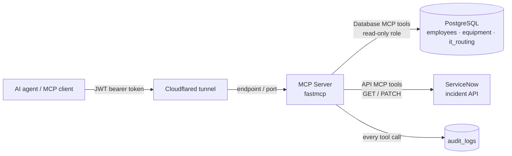

# mcp-enterprise-integration

> In active development: design and security model are defined. The MCP server, database, and ServiceNow tool modules are being built now. [Project Status](#project-status).

Agentic AI platform for integrating enterprise systems through a secure MCP server.

An MCP server exposes PostgreSQL and ServiceNow API access as tools the model calls. The agent looks up employees, equipment, and IT routing data in PostgreSQL, then triages ServiceNow incidents by updating their urgency, assignment group, and work notes.

Every tool call passes through three layers of least-privileged security: identity and access (JWT), hard-coded tooling constraints, and model reasoning.

This is a public, personal build of the MCP server platform pattern I ship in production for agentic AI, using PostgreSQL and the ServiceNow API in place of proprietary systems.

**Requirements:** Python 3.11+ · PostgreSQL · Docker Compose · Cloudflared · ServiceNow instance · `fastmcp` · `httpx` · `psycopg3` · `python-dotenv`

## Capabilities

| Capability | How it works |
| ---------- | ------------ |
| **JWT parsing for IAM in agentic AI** | Bearer tokens are validated and parsed to authenticate the caller and authorize which tools they can use |
| **PostgreSQL** | Database MCP tools connect with `psycopg3` through a locked-down, read-only role and query enterprise tables |
| **REST API access and data parsing** | API MCP tools call the ServiceNow incident API with `httpx`, parse JSON objects and arrays, and send allowlisted PATCH updates |
| **MCP server design** | Tools are exposed with `fastmcp`, containerized with Docker Compose, and reached through a Cloudflared tunnel |
| **Least-privilege security for AI agents** | Identity, code, and model-level controls each narrow what the agent can do |

## Design

- **3-level least-privileged security.** Each layer narrows what the agent can do, so no single layer is trusted on its own. See [Security](#security).
  1. **Identity & Access:** service account, user groups/roles, auth tokens.
  2. **Tooling:** Python code and function capabilities.
  3. **Model:** docstrings/descriptions and reasoning.
- **Data access only through tools.** The model never connects to PostgreSQL or ServiceNow directly; it calls tool functions the MCP server defines.
- **Docker Compose containers.** The MCP server and PostgreSQL run as containers in one Compose stack.
- **Cloudflared tunnel.** The MCP server is reached through a Cloudflared tunnel endpoint/port instead of being exposed directly.
- **Database MCP tooling.** Tools query the Employees, Equipment, and IT Routing tables.
- **API MCP tooling.** Tools read and update ServiceNow incidents.
- **Audit trail.** Tool activity is recorded in the Audit Logs table.
- **Secrets in `.env`.** Credentials and tokens stay out of the code and out of version control.

## Security

### Layer 1 | Identity & Access

- **Auth bearer token (JWT).** Every request's token is parsed and validated to authenticate (who is calling) and authorize (what they are allowed to call).
- **Locked-down database access role.** The database role used by the MCP server is read-only on the Employees, Equipment, and IT Routing tables.

### Layer 2 | Hard-Coded Constraints

- **Hard-coded Python controls.** Only approved fields are PATCHable.
- **Argument allowlist.** All args are checked against the list of approved args before any PATCH is sent to ServiceNow.

### Layer 3 | Model Reasoning

- **Docstring prompt engineering.** Each tool's docstring tells the model:
  - What the tool can do
  - What the tool can't do
  - What args can pass through

## User Guide | Installation

*(planned)* Installation steps will be added once the MCP server and Compose services are built.

Requires Docker Engine, Docker Compose plugin, Cloudflared, Python 3.11+, and access to a ServiceNow instance.

## User Guide | Configuration

| File | Holds |
| ---- | ----- |
| `.env` | Secrets: database credentials, JWT signing values, and ServiceNow instance URL and credentials (never committed) |

## User Guide | Operation

### Database Tables

| Table | Purpose | MCP server access |
| ----- | ------- | ----------------- |
| `employees` | Employee records | Read only |
| `equipment` | Equipment records | Read only |
| `it_routing` | IT routing data used to pick assignment groups | Read only |
| `audit_logs` | Audit trail of tool activity | Audit writes |

### ServiceNow API Resources

| Method | Resource | What it does |
| ------ | -------- | ------------ |
| `GET` | Incidents (`/api/now/table/incident`) | Returns a JSON object or an array of objects |
| `PATCH` | Incidents (`/api/now/table/incident/{sys_id}`) | Updates approved fields only: `urgency`, `assignment_group`, `work_notes` (solution) |

## Repo Layout

| Root | Purpose |
| ---- | ------- |
| `docker-compose.yaml` | Runs the MCP Server and PostgreSQL containers |
| `.env.example` | Template for the secrets `.env` file |
| `data` | Module holding postgres data outside of ephemeral postgres container |
| `db` | Module configuring postgres database |
| `server` | Module configuring MCP server |

## Libraries

| Library | Used for |
| ------- | -------- |
| `fastmcp` | MCP server and tool definitions |
| `httpx` | HTTP client for the ServiceNow API |
| `psycopg3` | PostgreSQL driver |
| `collections` | Standard library data structures for ETL |
| `logging` | Standard library logging for the audit trail |
| `dotenv` | Loads secrets from `.env` |

## Project Status

- [x] Scaffold repo folders and files
- [ ] Run MCP Server and PostgreSQL with Docker Compose
- [ ] Create Employees, Equipment, IT Routing, and Audit Logs tables
- [ ] Create read-only database access role
- [ ] Build MCP server with JWT parsing for authentication and authorization
- [ ] Build Database MCP tools
- [ ] Build ServiceNow API MCP tools: GET and PATCH incidents
- [ ] Enforce approved-args allowlist before every PATCH
- [ ] Write tool docstrings: can do, can't do, allowed args
- [ ] Record tool activity in the audit trail
- [ ] Expose the MCP server through a Cloudflared tunnel
- [ ] Move secrets to `.env` and add `.env.example`
